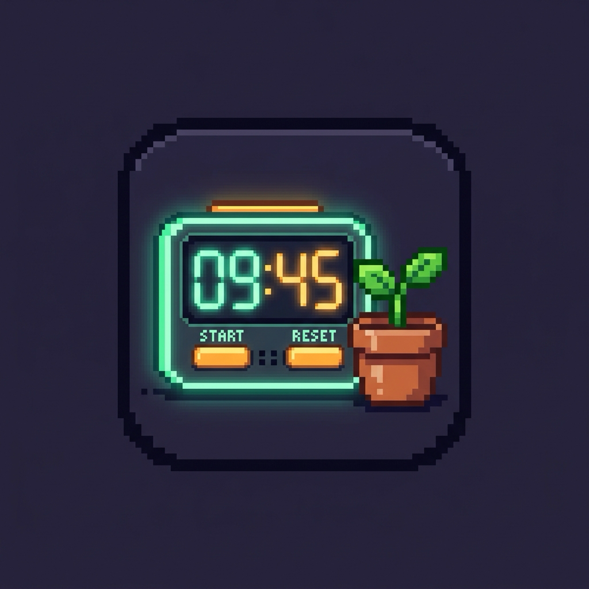

# EmberByte Focus OS (PixelFocus)

<div align="center">
  
  <h3>A Retro-Futuristic Offline Productivity Suite & Desktop Dashboard</h3>
  <p><b>Created by Swagato Bauri</b> (<a href="mailto:swagato731123@gmail.com">swagato731123@gmail.com</a>)</p>

  <p>
    
    
    
    
    
  </p>
</div>

---

## 📖 About The Project

**EmberByte Focus OS** is an all-in-one, offline-first productivity dashboard wrapped in a charming 16-bit retro arcade aesthetic. Designed for maximum focus and flow state, it provides an integrated suite of productivity tools without notifications, cloud distractions, or tracking.

All data is saved completely locally on your machine via `localStorage`, making it fast, private, and 100% functional offline.

---

## ✨ Features

- ⏱️ **Pomodoro & Custom Timer:** Classic 25m Focus, 5m Short Break, and 15m Long Break intervals, or dial in custom timer durations with retro progress bar visualizations.
- 📅 **Task Management & Interactive Calendar:** Daily to-do planner linked with a date picker calendar to organize tasks across dates.
- 🎯 **Mission Control (Goal Tracker):** Set and track Daily, Weekly, Monthly, and Yearly goals tagged across categories (Health, Aspirations, Education, Money, Character, Family).
- 📊 **Productivity & Session Tracker:** Visualize completed focus sessions across day, week, and month graphs.
- 🔁 **Dual Mode (Focus & Habit Tracker):** Switch seamlessly between Pomodoro Focus Mode and the comprehensive Habit Tracker dashboard.
- 🎨 **7 Handcrafted Theme Palettes:**
  - **Cyber Matrix** *(Default Flagship)*: Deep obsidian void with hyper-luminescent cyberpunk emerald (`#00f59b`).
  - **Neon Synthwave**: 80s arcade violet with electric magenta (`#ff2a85`).
  - **Glacier Ice**: Arctic deep blue with glowing cyan sky (`#38bdf8`).
  - **Solar Amber**: Vintage CRT terminal with radiant phosphor gold (`#f59e0b`).
  - **Sakura Bloom**: Twilight plum with vivid cherry blossom pink (`#f472b6`).
  - **Emerald Grove**: Deep pine moss with fresh jade green (`#10b981`).
  - **Studio Light**: Clean natural Japanese parchment with blueprint indigo (`#2563eb`).
- 🔊 **Brown Noise Audio Synthesizer:** Built-in ambient noise player with 'Deep', 'Medium', and 'Light' acoustic frequency presets to drown out ambient noise.
- 🌿 **Pixel Plant Companion:** An interactive animated pixel-art plant that sways gently as you work.
- 🔊 **Satisfying Retro SFX:** Authentic 8-bit click feedback for buttons, toggles, and completed sessions.
- ⏳ **Life & Year Progress Bars:** Real-time percentage bars showing how much of the current day, week, month, and year has elapsed.

---

## 🛠️ Architecture

- **Electron Main Process (`main.js`):** Controls window lifecycle, native display sizing, context isolation, and macOS dock icon integration.
- **Preload Script (`preload.js`):** Secure bridge script establishing context isolation and desktop environment standards.
- **Renderer UI (`pixel-focus-os.html` & `index.html`):** Single-page React UI transpiled directly with Babel and styled with responsive pixel-art utility styles.
- **Packaging Pipeline (`electron-builder`):** Zero-configuration native macOS `.dmg` generator producing signed/ad-hoc standalone disk image installers.

---

## 🚀 Getting Started

### Prerequisites

- [Node.js](https://nodejs.org/) (v18 or higher recommended)
- `npm`

### Installation

1. **Clone the repository:**
   ```bash
   git clone https://github.com/swagatobauri/emberbyte_electron_desktop.git
   cd emberbyte_electron_desktop
   ```

2. **Install dependencies:**
   ```bash
   npm install
   ```

3. **Start in Desktop Mode:**
   ```bash
   npm start
   ```

---

## 📦 Building the macOS `.dmg` File

To compile and package the standalone macOS installer (`.dmg`):

```bash
npm run dist
```

Once complete, the installer disk image will be available in the `dist/` directory:
- `dist/PixelFocus-1.0.0-arm64.dmg` (for Apple Silicon)
- Mount the `.dmg` and drag **PixelFocus** into your macOS **Applications** folder to install!

---

## 👤 Author & Ownership

- **Author:** Swagato Bauri
- **Email:** [swagato731123@gmail.com](mailto:swagato731123@gmail.com)
- **GitHub:** [@swagatobauri](https://github.com/swagatobauri)

---

## 📄 License

This project is open-source and distributed under the [MIT License](LICENSE).
